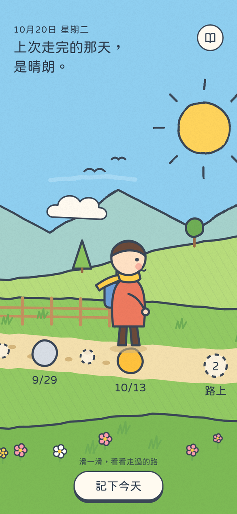
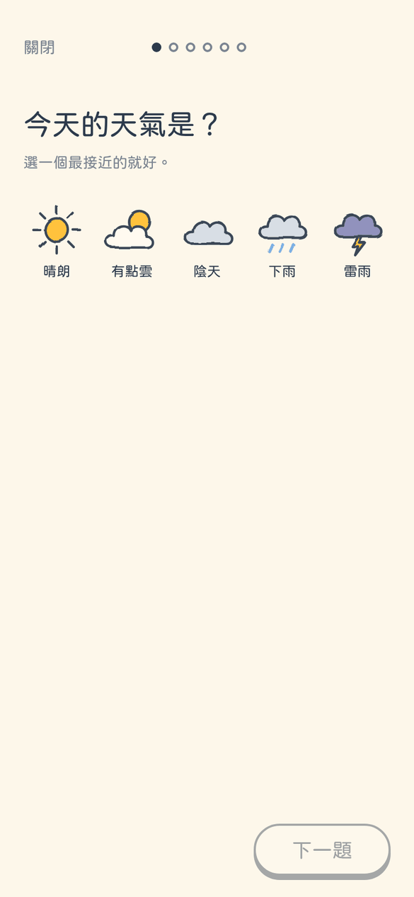
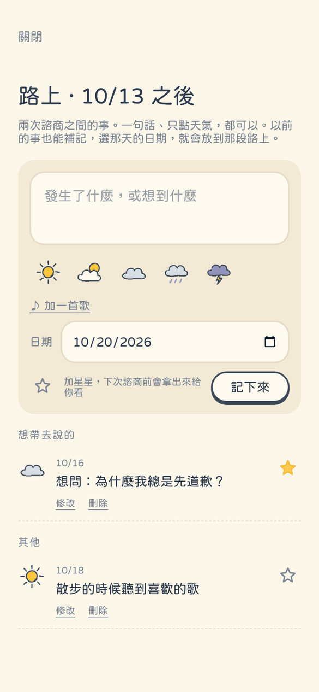
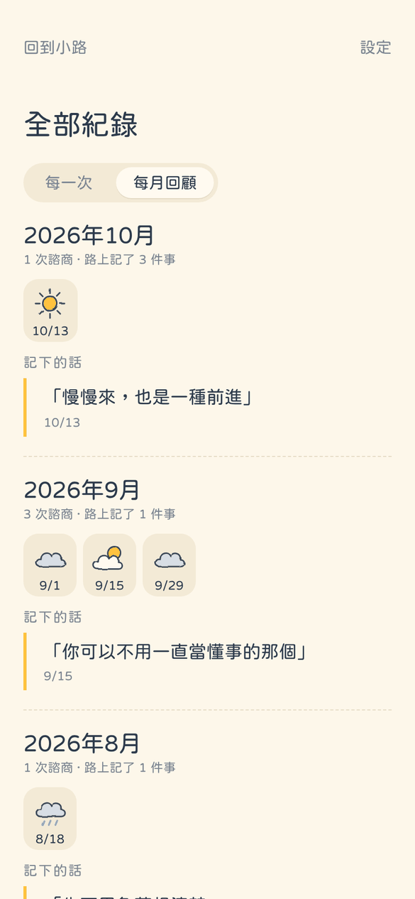

# Mind Map

**記住每一次諮商心情的小地方。**

藍天、草地、一條往前延伸的小路。每去一次諮商，路上就多一個圓點；兩次諮商之間的日子，是虛線的「路上」。小人站在最新的那一點，往回滑，就能看見自己走過的路。

這是一個給 iPhone 用的 Web App（PWA）。不用帳號、沒有伺服器，所有紀錄只存在你自己的手機裡。

<p align="center">
  
  
  
  
</p>

<sub>截圖裡是示範資料。</sub>

## 為什麼做這個

諮商結束後，心裡常常有很多東西，可是打字很累，過幾天又忘了那天是什麼感覺。
這個 App 想做的事很少：**讓記下來這件事變輕，讓走過的路看得見。**

- 只有「天氣」必選，其他都可以跳過。點一個天氣就算記了。
- 一題一頁，不用面對一整張表格。
- 沒有分數、沒有圖表、沒有 AI，也不會評價你的心情。
- 只給自己看。沒有分享，也不會傳給任何人。

## 功能

### 小路
橫向可以滑的繪本風景。實心圓點是一次諮商，顏色是那天的天氣；虛線圓點是兩次諮商之間的「路上」。
上方的一句話來自你自己的紀錄：「上次走完的那天，是晴朗」、「離下次諮商還有 3 天」、以前記下的一句話……一天換一句，點一下可以看下一句。

### 記下今天
先問「今天有去諮商嗎？」
- **有**：一題一頁——天氣、心情、談了什麼、印象最深的一句話、筆記、這次的歌。寫到一半可以「先存起來」，之後再補。
- **沒有**：記在「路上」。一句話、只點天氣、或只加一首歌都可以。加了星星的，下次諮商前會拿出來給你看。

### 全部紀錄
- **每一次**：每次諮商的完整內容，可以修改（包括日期）、刪除。
- **每月回顧**：照月份整理每次的天氣、這個月的歌和記下的話。
- **補記**：以前的諮商、路上的事都能補記，選那天的日期，就會照日期插進小路中間。

### 音樂（Spotify，可選）
每次紀錄可以附上一首歌。連結自己的 Spotify 帳號後：
- 用歌名搜尋，或從「剛剛聽的歌」裡點一首
- 在 App 裡用你手機上的 Spotify 播完整首（需要 Premium）
- 每次附上的歌會自動排進你 Spotify 裡的私人歌單「Mind Map」

不連結也可以：直接貼上 Spotify 的歌曲連結。

### 其他
- 下次諮商的日期、倒數
- 4 位數密碼鎖
- 加密備份與還原
- 求助專線

## 隱私

日記只存在你的手機裡（瀏覽器的 IndexedDB），沒有伺服器，也沒有任何分析或追蹤。

- **備份檔加密**：匯出時要設一組密碼，檔案用 AES-GCM 加密（金鑰由密碼經 PBKDF2-SHA256 60 萬次產生）。沒有密碼看不到內容。
- **背景時遮住畫面**：App 一離開前景就蓋上一片天空，多工畫面的截圖看不到內容。
- **密碼猜錯要等**：錯 5 次後要等 30 秒，之後每錯一次等待加倍，最多 15 分鐘；重開 App 不會重置。
- **安全標頭**：只執行本站的程式、只連到 Spotify、不允許別的網站嵌入（CSP 等，見 [`public/_headers`](public/_headers)）。
- **Spotify**：連結時用 PKCE，不需要密鑰；App 只會跟 Spotify 交換你選的歌，日記內容不會送出去。

> 資料在手機上，也就代表手機遺失或刪掉 App 時資料會跟著不見。請偶爾在設定裡「匯出備份」，存到「檔案」或其他地方。

## 這不是治療工具

「Mind Map」是陪你記錄的小本子，不能取代諮商或醫療。
如果你現在很難受，或有傷害自己的念頭，請找人說說話：

- 安心專線 **1925**（24 小時）
- 生命線 **1995**
- 張老師專線 **1980**
- 緊急狀況請撥 **119** 或 **110**

（以上是台灣的專線，App 的設定頁裡也找得到。）

---

## 自己架一個

這個 App 沒有後端，只要放到任何能放靜態網頁的地方就能用。下面是用 Cloudflare 的做法。

### 部署到 Cloudflare Workers

1. Fork 這個 repo。
2. 到 [Cloudflare](https://dash.cloudflare.com/) → **Workers & Pages** → **Create** → **Import a repository**，選你的 fork。
3. **Settings → Build** 裡，Deploy command 用 `npx wrangler deploy`，Root directory 是 `/`。Build command 可以留空（[`wrangler.jsonc`](wrangler.jsonc) 會在部署前自己執行 `npm run build`）。
4. 網址會是 `https://mindweb-mymap.<你的帳號>.workers.dev/`。

之後推到 `main` 會自動更新；推到其他分支會產生預覽網址。

也可以用 **Cloudflare Pages**：Build command `npm run build`、Build output directory `dist`、環境變數 `NODE_VERSION` = `22`。

### 在 iPhone 上安裝

用 **Safari** 打開網址 → 下方「分享」→「加入主畫面」。

- 主畫面的 App 和 Safari 裡的資料是分開的，請一直從主畫面的圖示打開。
- 更新不用重新加入主畫面：App 打開或切回前景時會自己檢查新版本。剛打開就換上；用到一半發現的，等你離開 App 時才換，不會打斷正在寫的紀錄。

### 連結 Spotify

1. 到 [Spotify for Developers](https://developer.spotify.com/dashboard) 建立一個 App（開發模式即可），API 勾選 **Web API**。
2. **Redirect URI** 填 App 設定頁上顯示的網址（例如 `https://mindweb-mymap.<你的帳號>.workers.dev/`）。
3. 把 **Client ID** 貼到 App 的「設定 → Spotify」，按「連結 Spotify」。

連結時會請求：控制播放、讀取播放狀態、讀取正在播放與最近播放、讀取與編輯私人歌單。

播放有三種：Spotify 官方嵌入播放器（在 iPhone 上通常只能試聽片段）、「用我的 Spotify 播完整首」（需要 Premium，遙控你手機上的 Spotify；找不到裝置時先打開 Spotify 一下再按）、以及直接在 Spotify 打開。

## 開發

```bash
npm install
npm run dev        # http://localhost:5173
npm test           # 單元測試
npm run build      # 型別檢查＋打包到 dist/
npm run icons      # 從 public/icons/favicon.svg 產生 PNG 圖示
```

- **技術**：Vite、React、TypeScript、Dexie（IndexedDB）、vite-plugin-pwa、粉圓字型（jf open 粉圓）。
- **風景**是程式畫的 SVG（[`src/lib/scenery.ts`](src/lib/scenery.ts)）。手繪的歪斜感直接畫進形狀裡，不用即時濾鏡；會動的雲和蝴蝶只用 transform，在 iPhone 上捲動才會順、不發燙。
- **資料**：[`src/lib/store.ts`](src/lib/store.ts) 處理新增、修改和補記；一則「路上」屬於它日期之前的最後一次諮商，補記一次諮商時，會把那段路上之後的事分過去（[`src/lib/stretch.ts`](src/lib/stretch.ts)）。
- 產品構想與製作過程：[`docs/ROADMAP.md`](docs/ROADMAP.md)；最早的樣稿：[`mockup/home.html`](mockup/home.html)。

## 授權

[MIT](LICENSE)。可以自由使用、修改、分享，保留授權聲明即可。
